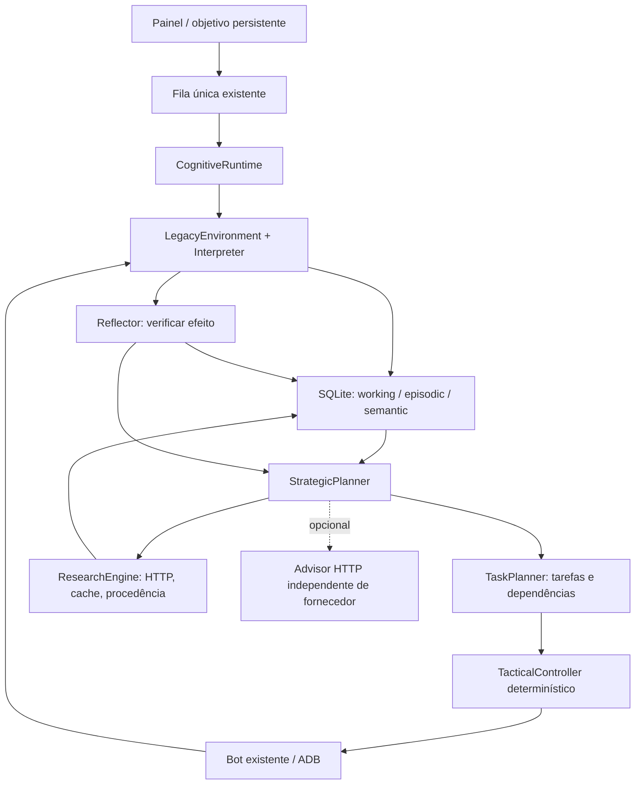

# Arquitetura cognitiva 0.2

## Antes e depois

Antes: painel → fila → Bot monolítico → OCR/ADB ou sequência JSON. O estado operacional residia em variáveis; links de guias eram apenas referências.

Depois: o mesmo painel, fila, OCR, ADB, rotas e controles continuam funcionando. Um pacote Python no mesmo processo acrescenta:



Não foram criados vários agentes, serviços de nuvem ou outro servidor de execução. O HTTP local já existente continua sendo a interface do processo.

## Responsabilidades

| Arquivo | Responsabilidade |
|---|---|
| `contracts.py` | Tipos de observação, ação, tarefa, resultado e procedência; validação dos argumentos |
| `perception.py` | Adaptação do OCR/CV, distinção de fase principal/passagem, identidade contextual, saúde aproximada e checkpoints |
| `planning.py` | Estratégia de alto nível, decomposição, dependências, critérios, controle tático e reflexão |
| `memory.py` | SQLite versionado, transações, integridade, recuperação contextual, backup e lease de execução |
| `research.py` | Formulação de consultas, descoberta RSS, extração HTTP, cache, limites e conflitos entre alegações |
| `advisor.py` | Protocolo opcional de estratégia estruturada, sem comandos privilegiados do modelo |
| `local_model.py` | Modelo textual local Qwen3-0.6B, processo llama.cpp limitado e cancelável, sem serviço adicional |
| `runtime.py` | Ciclo integrado, journal de efeitos, checkpoints, reconciliação, replanejamento e métricas |
| `bot.py` | Integração na fila e no painel existentes; controles legados preservados |

## Ciclo e sucesso verificável

OBSERVAR → INTERPRETAR → RECUPERAR MEMÓRIA → PLANEJAR → EXECUTAR → OBSERVAR NOVAMENTE → VERIFICAR → REFLETIR.

Uma tarefa possui ID, objetivo e pai, escopo, pré-condições, dependências, critério de sucesso, estado, tentativas, orçamento, recuperação e IDs de evidência. Estados: pending, running, interrupted, blocked, completed, failed e replanned. Dependências inexistentes, entre objetivos ou cíclicas são rejeitadas transacionalmente.

O objetivo duradouro é avançar na história. Cada fase recebe um objetivo de conclusão com critério visual. A estratégia decompõe o trabalho conforme evidências: identificar a fase, retomar a interface, executar passos de um trecho conhecido, combater inimigos visíveis, investigar uma lacuna e verificar a conclusão. Tarefas de rota têm dependências ordenadas e o trecho exige checkpoint de destino.

O controlador determinístico escolhe movimentos/ataques curtos. Ele não chama modelo por comando. Sucesso de envio ADB não é sucesso da tarefa: é necessário observar a transição de interface, o checkpoint esperado, movimento local ou o critério específico. Movimento local não prova conclusão de fase. A tela de conclusão precisa de identidade de fase e de duas observações corroborantes. Concluir a fase nunca equivale a concluir toda a história.

## Memória persistente

Banco: `data/cognitive.sqlite`, schema 1. SQLite do runtime: 3.49.1. Usa rollback journal, synchronous FULL, foreign_keys, busy_timeout, transações explícitas e uma conexão protegida por lock. A política evita assumir comportamento WAL de distribuições mais novas. `quick_check` ocorre na abertura; corrupção causa erro explícito, nunca substituição silenciosa. O backup usa a API SQLite e fecha a conexão de destino.

- Working: observação atual, fase, interface e objetivo, por chave estável do objetivo.
- Episodic: resultados, falhas, replanejamentos, consultas e reconciliações com evidências.
- Semantic: guias relatados, pesquisas e estratégias validadas por checkpoints.

Registros têm fonte/método, timestamp, escopo, confiança e validação (hypothesis, reported, verified, contradicted ou uncertain). `verified` refere-se ao fato especificamente observado, não a uma garantia de que todo o conteúdo de uma tela ou hipótese seja verdadeiro. Fontes externas entram como reported. Guias legados importados também não são promovidos a verdade.

A recuperação limita o contexto por fase, tipo de memória e quantidade. Falhas anteriores são consultadas separadamente para não desaparecerem atrás de observações recentes. Conhecimento genérico do mundo é recuperado em pequena quantidade. Há testes de que uma falha persistida impede repetir a rota na sessão seguinte e de que uma estratégia validada influencia uma decisão futura.

## Pesquisa externa

Gatilhos: identidade desconhecida, ausência de rota validada, tentativa fracassada ou lacuna de pré-requisitos. O planejamento consulta primeiro a memória. A investigação formula uma consulta por fase, busca via Bing RSS e complementa com referências do catálogo existente; páginas são acessadas por HTTP público e transformadas em trechos curtos com URL, hash e horário. Não há análise/transcrição de vídeo: links/snippets de vídeo são rotulados como tal.

O orçamento padrão é de cinco requisições por execução. Cache de consultas: 24 horas; pequenas respostas HTTP: 6 horas. Falta de fonte utilizável é registrada para não repetir indefinidamente a consulta. URLs de pesquisa aceitam HTTPS público, com validação de destino e redirecionamentos, limite de tamanho e timeout. Páginas, snippets e respostas de modelo são dados não confiáveis. Nenhum desses conteúdos é executado como script ou instrução privilegiada.

Conflitos podem ser representados como alegações estruturadas (subject/property/value/source); valores incompatíveis são registrados como disputed, sem escolher um vencedor por conveniência. Extração de alegações em linguagem natural aberta ainda depende de um modelo configurado ou de regras específicas. A extração de trechos por si só não resolve puzzles.

## Modelo opcional e limites de inteligência

As sondagens iniciais não encontraram LLM/VLM em execução. Para demonstrar integração real sem credenciais, foi acrescentado o modelo textual oficial Qwen3-0.6B Q8 (639.446.688 bytes), via binário CPU x64 oficial llama.cpp b12192. O modelo e o ZIP do runtime tiveram SHA-256 comparados com os metadados oficiais. Arquivos, licenças e manifestos ficam em `models/` e `tools/llama/`, no disco E:.

O modo local está habilitado em `config.json`, usa duas threads, até três chamadas estratégicas por execução e timeout de 60 segundos. Cada chamada inicia um processo curto e o encerra ao terminar; não há servidor de modelo residente, nuvem, instalação global ou tarefa agendada. A parada manual mata o subprocesso em execução. O contexto é reduzido; não há chamada por comando tático. O modelo só é chamado com o jogo pausado ou em menus identificados. Antes de pesquisa HTTP iniciada dentro da fase, uma subtarefa abre e verifica o mapa; ao bloquear uma continuação desconhecida, o agente tenta pausar a fase por uma ação também verificada.

As regras continuam validando as possibilidades: o modelo só pode sugerir rota conhecida se houver uma rota compatível e só pode sugerir combate se houver um inimigo observado. O primeiro teste real sugeriu uma rota inexistente: a falha foi preservada em `evaluations/real-model-first-failure.json`. Após impor possibilidades sustentadas pelo contexto, o teste escolheu inspeção. Isso prova inferência textual real e a necessidade das guardas, não competência geral para puzzles.

`HttpAdvisor` continua disponível para outro fornecedor que implemente o protocolo `guardian-strategy-v1`. Não há credenciais gravadas; um token opcional é lido de uma variável de ambiente indicada na configuração. Trocar o backend para HTTP exige configurar o serviço; um endpoint de chat genérico precisa de adaptador.

Pedido: contexto limitado (observação estruturada, memórias, tarefas, orçamento). Resposta JSON:

```json
{"strategy":"research","reason":"Missing route evidence","evidence_ids":["observation_id"],"usage":{"input_tokens":100,"output_tokens":20,"cost_usd":0.001}}
```

Estratégias contratuais: inspect, research, known_route, combat, explore, wait e stop; a lista realmente permitida é reduzida às possibilidades sustentadas pela percepção. Elas são sugestões; guardas, evidências e decomposição continuam controlando os comandos. IDs de evidência inventados são rejeitados. Não há envio de imagens por esses adaptadores; um VLM pode ser integrado em outra implementação do contrato sem acoplar o núcleo a um fornecedor.

O teste HTTP local com resposta simulada prova apenas o protocolo. A avaliação `real_model.py` usa os pesos reais e registra resposta, latência e contagem de tokens do llama.cpp. Custos/tokens sem informação do provedor são desconhecidos, não inventados como zero. Inferência local não tem cobrança de API; eletricidade e hardware não foram estimados. Execuções sem modelo não consomem tokens de modelo.

## Recuperação e concorrência

Antes do efeito, são persistidos tarefa, observação, checkpoint e operação. A operação é marcada issued antes do envio. Se o processo cair nesse intervalo, a retomada considera o resultado incerto. Ela observa o estado real; se o checkpoint de destino comprovar o resultado, conclui a tarefa sem repetir o comando. Caso contrário, invalida os passos dependentes da posição e replaneja. Um estado salvo nunca substitui uma observação fresca.

A fila continua permitindo apenas uma execução. O modo cognitivo também usa um lease SQLite com expiração e renovação; dois executores não podem controlar simultaneamente a mesma memória. Parar cancela a execução cooperativamente. Leituras de rede/OCR já em andamento podem terminar até o respectivo timeout; nenhum comando seguinte deve ser enviado após a parada. Holds ADB têm duração máxima de 1,5 s.

Falhas são separadas em execução, percepção, planejamento e ferramenta. Tentativas têm limites. A repetição sem progresso produz abandono da abordagem, memória episódica e investigação ou bloqueio explícito. Loja, reviver e interfaces não reconhecidas não são atravessadas automaticamente.

## Avaliar e usar

```text
tools\python\python.exe -X utf8 test_bot.py
tools\python\python.exe -X utf8 test_cognitive.py
tools\python\python.exe -X utf8 evaluations\harness.py
tools\python\python.exe -X utf8 evaluations\perception_corpus.py
tools\python\python.exe -X utf8 evaluations\live_research.py
```

Os primeiros quatro comandos dispensam o jogo real. A pesquisa ao vivo usa Internet e escreve apenas no banco de avaliação. No painel, Só observar não envia comandos ao jogo; Executar / retomar executa um orçamento limitado e preserva o objetivo. O jogo continua avançando durante uma parada apenas do bot: use a pausa do próprio jogo quando houver perigos.

## Limites e próximos marcos

Não há solucionador universal de puzzles, navegação de todos os mapas, esquiva validada de armadilhas/projéteis ou prova de concluir a história. Saúde e inimigos são aproximações de visão; a ausência de uma barra significa ausência observada, não inimigos inexistentes fora da tela. O teste de três capturas não mede precisão geral. O benchmark sintético não mede taxa de vitória real.

Próximos marcos: avaliar um modelo mais capaz e um VLM se necessário; enriquecer percepção de minimapa/objetos/armadilhas; validar o controlador em trechos adicionais; extrair estratégias estruturadas com comparação entre fontes; ampliar corpus e tarefas. Cada marco exige novas evidências antes de promover a capacidade a validada.
